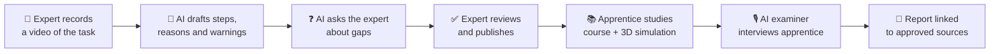
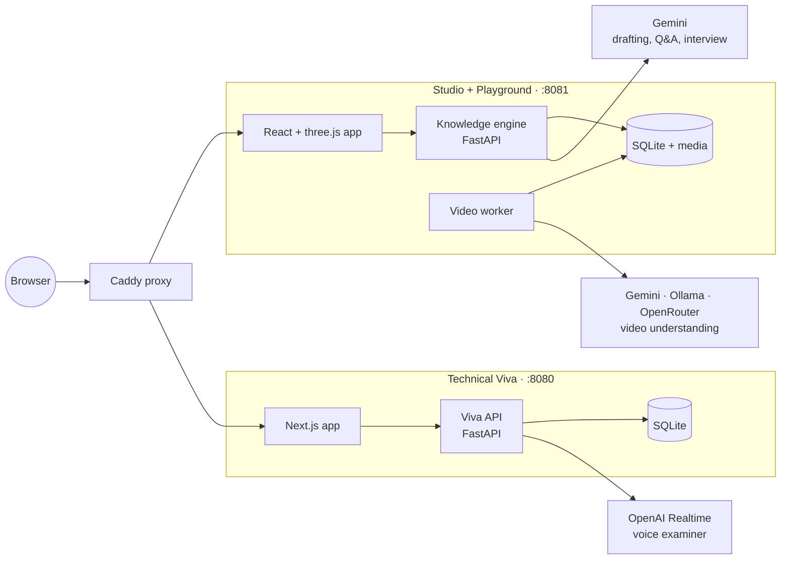

<p align="center">
  
</p>

<p align="center">
  <b>Turn an expert's hands-on know-how into training for the next generation.</b><br>
  Built for <b>JETRO PS-03 · Japan Hackathon 2026</b>
</p>

---

**Takumi** (匠, Japanese for "master craftsman") records the practical knowledge of experienced technicians and turns it into training for apprentices. An expert films themselves doing a job. AI writes a first draft of the steps, reasons and warnings. The expert checks and approves it. Apprentices then learn from it through a course, a 3D simulation and an AI interview.

The demo uses one real-world task: **inspecting a shaft and bearing**.

## Why it matters

Skilled workers are retiring, and much of what they know was never written down. Manuals say *what* to do. They rarely say *why*, or how a fault looks, sounds or feels. When those experts leave, that knowledge leaves with them.

Takumi captures it while the expert is still here, keeps a human in charge of what is taught, and gives apprentices a safe place to practise.

## How it works



| Part | Who uses it | What it does |
| --- | --- | --- |
| **Expert Studio** | Expert | Upload a recording. AI drafts the procedure and asks about anything unclear. The expert edits, approves and publishes a locked version. |
| **Apprentice Playground** | Apprentice | Course lessons plus an interactive 3D bearing assembly with scored practice scenarios. |
| **Technical Viva** | Apprentice | An animated AI examiner asks questions by voice or text, follows up, then writes a report that cites its sources. |

**Ground rules built into the code**

- AI output is always a draft. Nothing reaches apprentices until a human approves it.
- Published knowledge is locked. Changes create a new version.
- Answers and grades use only approved knowledge, and every claim points back to its source.

## Architecture



## Tech stack

| Layer | Tools |
| --- | --- |
| Frontend | React 19, Vite, three.js (React Three Fiber), Next.js 15 |
| Backend | Python, FastAPI, SQLAlchemy, SQLite, Alembic |
| AI | Google Gemini, OpenAI Realtime, optional Ollama / OpenRouter |
| Tooling | uv, pytest, ruff, Playwright, Docker Compose, Caddy |

## Quick start

Requires Docker.

```sh
cp .env.example .env
docker compose up --build
```

| URL | Opens |
| --- | --- |
| http://localhost:8081 | Apprentice course and 3D playground |
| http://localhost:8081/studio | Expert Studio |
| http://localhost:8080 | Technical Viva |

Demo mode runs offline with clearly labelled sample data. Add API keys to `.env` and `takumi-backend/.env` for live AI.

## Repository map

| Path | Contents | Docs |
| --- | --- | --- |
| `takumi-backend/` | Knowledge engine: drafts, reviews, releases, grounded Q&A | [README](takumi-backend/README.md) |
| `src/`, `e2e/` | Apprentice playground, 3D simulation, Studio UI | [PLAYGROUND.md](PLAYGROUND.md) |
| `backend/`, `frontend/` | Technical Viva API and web app | [docs/VIVA.md](docs/VIVA.md) |
| `deploy/`, `docker-compose.yml` | Container images and routing | — |
| `markdowns/` | Concept, specs and API contract | [Hackathon guide](markdowns/hackathon/README.md) |

## Team

[@aktionknight](https://github.com/aktionknight) · [@himanishpuri](https://github.com/himanishpuri) · [@ManasMehta12](https://github.com/ManasMehta12) · [@sauryagur](https://github.com/sauryagur)

> Demo content is illustrative. It must not be used for real torque, tolerance or safety decisions.
